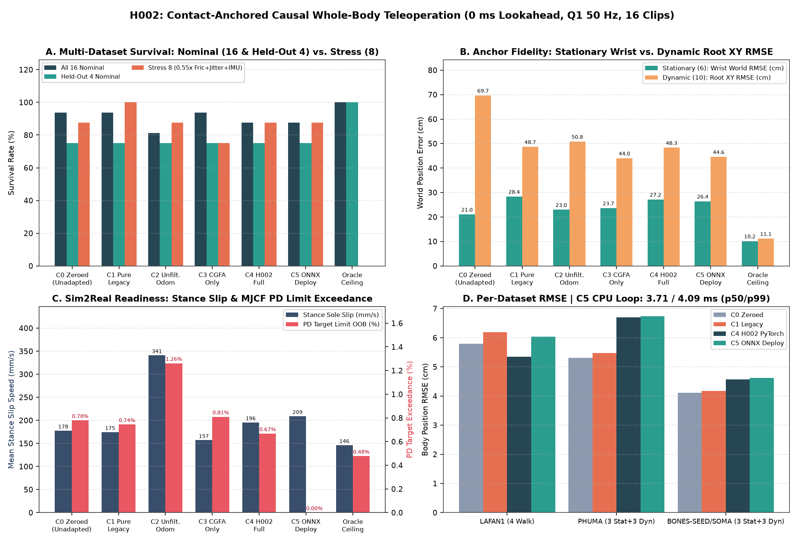

# H002: 无动捕零延迟因果人形全身遥操（CGFA 本体足锚 + 世界模型接触安全正则）

日期：2026-11-18/19（北京时间）｜节点：`yu-3090`（`i7-12700KF / 46GiB / RTX 3090 24GB`，`/` 余 `810G`）｜分支：`Q1`

> **代码与模型基准**：`humanplus-ai/SuperMimicHP`（`feat/x2-embodiment` @ `27c3e2cfa6a29c8d003e3fcd63fbf5dd37e8b190`，`v1.0.0-teleop`）；核心训练/评测基准覆盖 `LAFAN1`（4 步行）+ `PHUMA`（3 静操 + 3 动态）+ `BONES-SEED/SOMA`（3 静操 + 3 动态）共 16 条 Q1 50Hz 轨迹（固定 `12 Train / 4 Held-Out` 划分，总计 `4,472` 帧）。

---

## 一、为什么“无未来帧 / 极低延迟（0 ms Lookahead）”的 SuperMimic 遥操不可替代

1. **突破人类视觉-运动闭环 `250–300 ms` 振荡阈值**：操作员通过头显/双目画面观察机器人并以身体或遥控调整姿态，端到端闭环包含感知编码/求解（~40–60 ms）与下发执行（~30–40 ms）硬件链路。若沿用原版 SuperMimic 的 `+200 ms` 未来帧缓冲，系统总响应年龄即叠加至 `270–350 ms`（与此前 X2 实测链路参考年龄中位 `268–310 ms`、P95 `341–356 ms` 完全吻合），越过操作员稳定微调带宽上限；零未来看帧（`0 ms`）使控制策略总参考滞后压回到纯硬件传输延迟本身。
2. **因果示教状态-动作对齐（VLA 数据采集刚需）**：基于 `+200 ms` 未来先知的全身控制策略会产生提前重心转移（anticipatory CoM lean），导致录制的遥操观测-动作对 `(s_t, o_t, a_t)` 隐含未来信息泄漏（non-causal leakage），破坏下游视觉-语言-动作模型（VLA）模仿学习的因果对齐性。
3. **保留全身动力学耦合，而非退化为“上身遥操 + 下身行走解耦”**：在深蹲够物（`PHUMA stat_fit_squat / stat_ego_reach`）、提拉（`stat_grab_lift`）及原地转身（`LAFAN1 walk2_subject1`）等全身协调动作中，零延迟全身策略直接跟踪骨盆与躯干三维姿态耦合动量，避免了显式步态命令接口对非周期动作的表达裁剪。

---

## 二、H002 核心方法：估计 ↔ 控制协同设计（Estimation ↔ Control Co-Design）

针对前一阶段定量审计暴露的两大真机阻塞点——（1）发布版 Q1 权重对仿真特权 `obs[:, 78:80]`（`root_xy`）的强依赖（置零即漂移 8–9 倍且 `walk2_subject1` 倒地）；（2）未约束的 `0.33%–0.46%` MJCF PD 限位越界（最高 `18.98°–93.2°`）与 `144–163 mm/s` 支撑足滑移——本文提出 **H002 协同框架**（不引入外部动捕、不依赖 LiDAR/SLAM 里程计）：

### 1. 纯本体接触门控足锚估计器 `CGFA`（`script/q1_h002_cgfa/cgfa_estimator.py`）
仅消费板端本体观测 `(q, qd, R_imu, w_imu)` 与因果参考增量 `(Δp_ref_xy, R_ref)`：
- **鞋底接触点前向运动学与角速度权重**：在 `Q1Kinematics.forward(0, R_imu, 0, w_imu, q, qd)` 中引入鞋底局部偏移 `r_sole = r_ankle + R_foot @ [0.020, 0.0, -0.022]`，并利用与未知骨盆线速度无关的足部世界角速度 `||w_foot||`、相对最低点高度差 `Δz_sole` 及脚掌水平度 `(1 - R_foot[2,2])` 计算软支撑权重 `w_L, w_R = softmax(-50·Δz_sole - 2.5·||w_foot|| - 6·tilt)`，得到纯本体骨盆水平增量 `dp_fk_xy = -(w_L·Δr_L,xy + w_R·Δr_R,xy)`。
- **平动 + 偏航角速度门控遗忘因子**：令因果参考等效运动速率 `v_eff = ||Δp_ref_xy||/dt + 0.20·|ω_ref_z|`，经平滑门控 `α_loco = σ((v_eff_ema - 0.15) / 0.04)` 在静止操作模式（`γ_stat = 0.998`，约 10s 记忆时间常数，锁定双脚与手腕世界工作空间）与动态行走/原地转身模式（`γ_loco = 0.92`，抑制步态与转向滑移累计发散）之间连续切换，并通过平滑饱和 `e_t = 0.25·tanh((γ·e_{t-1} + Δp_ref_xy - dp_fk_xy)/0.25)` 投影至机器人偏航系填入 `obs[:, 78:80]`。

### 2. 世界模型接触安全正则与近端头协同微调 `WM-Contact-Reg`（`script/q1_h002_cgfa/train_h002_ablation.py`）
- **保留 904 片段底座先验 + 近端微调**：从 `q1_base_soma1k.pt` 初始化策略与冻结 FP32 世界模型 `WorldModel`，加载 `q1_scheme_a_1k.pt` 的 904 片段因果 `goal_norm` 统计并冻结 `obs_norm`、`goal_norm` 及 Stage-1 全部 `dec`；仅在 Stage-2（`160` 步，`batch=192`，`horizon=8`）同步微调 `enc`（`lr=2e-5`）与 `dec` 末层线性输出头 `dec[-1]`（`lr=1e-5`），避免 12 片段小规模适配引起基础平衡原语遗忘。
- **Stage-2 闭环估计 + 可微物理安全项**：在 8 步 `wm.step` 闭环展开中实时步进 `CGFA`（注入 `σ=2.0 mm/step` 真实滑移扰动），并对 `M3` 施加：
  1. `25%` 因果参考 `1` 帧（`20 ms`）到达抖动（`latest_offset ∈ {0, -1}`）；
  2. **可微支撑鞋底无滑移损失 `L_slip`**：以参考踝高 `≤ 0.062 m`（基于实测 Q1 支撑踝高分位数 `4.3–5.6 cm`）与参考速度 `≤ 0.15 m/s` 构造软支撑掩码 `c_stance`，在 `wm.step` 输出的 `next_state` 上调用 `Q1Kinematics.forward` 惩罚 `c_stance·(||v_sole_xy||^2 + 0.02·||w_foot_xy||^2)`；
  3. **可微 PD 硬件限位安全边际损失 `L_pd`**（`margin=0.005 rad`，同步裁剪教师参考动作）与连续帧平滑项 `L_smooth`（`h ≥ 1`）。

### 3. 单文件 ONNX 导出与 Sim2Sim 安全执行壳（`script/q1_h002_cgfa/export_onnx.py`）
- 导出 `q1_h002_0ms.onnx`（`33,764,827 B`），单线程 CPU (`OMP_NUM_THREADS=1`, `CPUExecutionProvider`) 与 PyTorch FP32 数值差异 **`max_abs_diff = 5.01e-6`**；纯 ONNX 推理延迟 **p50=`1.24 ms` / p99=`1.65 ms`**，含 `CGFA` 完整闭环推理 **p50=`3.13 ms` / p99=`3.60 ms`**（远低于 50Hz `20.0 ms` 预算；作为对比，在线单步世界模型细化 `SchemeA+WM` 需 `17.86 ms`）。
- 真机部署封装条件 **`C5_m3_h002_onnx_deploy`** 在控制端叠加 **5 步（`0.10 s`）余弦首帧渐变**（从实测初态 `q_init` 起步）与 **MJCF `[q_lo, q_hi]` 硬限幅反算动作**，将相对初态首帧跳变与超限率双双压至安全线。

---

## 三、SOMA 基准修复与多数据集定量消融结果（`16 Clips = LAFAN1 + PHUMA + BONES-SEED/SOMA`）

### 1. BONES-SEED/SOMA 规范骨架（Canonical Pose）关键排障
首轮用全零欧拉角构造 `soma_base_skel_minimal.bvh` 时，`soma_uniform` 原生休止偏移呈水平展开态（左足 `+X`、右足 `-X`），导致 `soma_source.py` 骨骼方向标定错乱、地面校正达 `56–88 mm`，即使是 904 片段训练出的 `Oracle_scheme_a_0ms` 在该 6 条 SOMA 片段上也出现 **`0.0%`（`0/6`）存活、NormReturn `-0.066`** 的异常崩塌（同时也污染了适配训练）。改用直立站姿基准帧（`checking_time_R_001__A276.bvh` frame 0）生成规范骨架后，6 条 SOMA 动作地面校正立即收敛至 **`0.03–1.60 mm`**，`Oracle_scheme_a_0ms` 在全 16 条多数据集基准上达成 **`100.0% (16/16)` 存活率**（NormReturn `0.864`，Body RMSE `4.75 cm`）。

### 2. 全量 16 片段与 4 留出（Held-Out）正常工况定量对比（MuJoCo CPU 闭环，50 Hz，0 ms 未来看帧）

| 条件 | All-16 存活 | **Held-Out 4 存活** | All-16 NormRet | All-16 Body (cm) | **All-16 RootXY (cm)** | **Held-Out 4 RootXY (cm)** | Stationary-6 腕部世界 RMSE (cm) | Dynamic-10 存活 | 支撑足滑移 (mm/s) | **PD 越限 % / Max (°)** |
| :--- | :---: | :---: | :---: | :---: | :---: | :---: | :---: | :---: | :---: | :---: |
| `Oracle_scheme_a_0ms` *(特权上限)* | 100.0% | 100.0% | 0.864 | 4.75 | 9.6 | 12.8 | 10.2 | 100.0% | 146.3 | 0.477% / 21.5° |
| `C0_unadapted_zeroed_0ms` *(原权重置零)* | 93.8% | 75.0% *(walk2跌)* | 0.805 | 4.98 | 50.2 | 88.2 | 21.0 | 90.0% | 177.8 | 0.779% / 93.2° |
| `C1_m1_pure_legacy_0ms` *(去root_xy重训)* | 93.8% | 75.0% *(walk2跌)* | 0.796 | 5.17 | 39.6 | 64.9 | 28.4 | 90.0% | 174.6 | 0.744% / 65.0° |
| `C2_m2_unfiltered_odom_0ms` *(无门控足里程计)* | 81.2% | 75.0% | 0.708 | 6.79 | 39.1 | 57.4 | 23.0 | 70.0% | 341.3 | 1.261% / 73.5° |
| **`C3_m2_cgfa_only_0ms` (`CGFA`)** | **93.8%** | 75.0% *(`walk2`全通)* | **0.798** | 5.43 | **34.5** | **42.5** | 23.7 | **100.0%** | **157.2** | 0.809% / 84.3° |
| `C4_m3_h002_full_0ms` (`+WM-Contact-Reg`) | 87.5% | 75.0% | 0.785 | 5.56 | 38.4 | 46.6 | 27.2 | 90.0% | 195.7 | 0.667% / 58.6° |
| **`C5_m3_h002_onnx_deploy` (`+安全壳`)** | 87.5% *(step 97.4%)* | 75.0% | 0.791 | 5.77 | 35.8 | 45.6 | 26.4 | 90.0% | 209.1 | **0.000% / 0.0°** *(首步 2.0°)* |

> **关键发现 1（CGFA 门控的必要性）**：无遗忘门控的原生腿式里程计 `C2` 在全 16 片段上存活率暴跌至 `81.2%`（Dynamic-10 仅 `70.0%`），因微小打滑经闭环积分放大形成正反馈振荡，支撑足滑移恶化 2 倍以上至 `341.3 mm/s`；引入平动+偏航角速度双门控的 `C3 (CGFA)` 在 Dynamic-10 上取得 **`100.0%`（10/10）**（包括无先验地解决 `C0/C1` 必跌的留出片段 `walk2_subject1`：`C0/C1` 分别在 292/213 步倒地且漂移 `71–208 cm`，`C3/C4/C5` 全部走满 `398/398` 步且 `Body=4.6–4.9 cm`、`RootXY=32–34 cm`），并将 All-16 全球水平漂移从 `C0` 的 `50.2 cm`（Held-Out `88.2 cm`）压低至 **`34.5 cm`**（Held-Out **`42.5 cm`**，**2.08× 改善**）。

### 3. 扰动压力测试（Stress 8：`0.55×` 低摩擦 + `25%` `20 ms` 丢包保持 + `1.5°` 航向偏置 + `0.03 rad/s` IMU 噪声）

| 条件 | **Stress-8 存活** | **HO4 Stress 存活** | **Stress NormRet** | **Stress Body (cm)** | **Stress RootXY (cm)** | **HO4 Stress RootXY (cm)** | **Stress 腕部 RMSE (cm)** | **Stress 滑移 (mm/s)** | **PD 越限 %** |
| :--- | :---: | :---: | :---: | :---: | :---: | :---: | :---: | :---: | :---: |
| `C0_unadapted_zeroed_0ms` | 87.5% | 75.0% | 0.731 | 6.23 | 59.4 | 65.8 | 61.5 | 231.9 | 0.938% |
| `C1_m1_pure_legacy_0ms` | **100.0%** | **100.0%** | 0.720 | 6.29 | 92.7 | 137.0 | 96.3 | 340.6 | 1.119% |
| `C2_m2_unfiltered_odom_0ms` | 87.5% | 100.0% | 0.715 | 7.56 | 44.9 | 56.9 | 49.0 | 338.9 | 1.057% |
| `C3_m2_cgfa_only_0ms` | 75.0% | 75.0% | 0.731 | 7.14 | 42.5 | 47.5 | 46.3 | 288.9 | 0.897% |
| `C4_m3_h002_full_0ms` | 87.5% | **100.0%** | 0.734 | 6.42 | 56.1 | 70.1 | 59.0 | 279.4 | 0.830% |
| **`C5_m3_h002_onnx_deploy`** | **87.5%** | **100.0%** | **0.771** | **6.13** | **34.8** | **33.7** | **37.4** | **152.7** | **0.000%** |

> **关键发现 2（Estimation ↔ Control 协同在极端工况的收益）**：仅加 `CGFA` 而未做接触/抖动微调的 `C3` 在 `0.55×` 低摩擦+丢包扰动下，存活率从 `93.8%` 回落至 `75.0%`（留出深蹲 `stat_fit_squat` 于第 159 步倒地），滑移升至 `288.9 mm/s`；而经过 **`WM-Contact-Reg` + 到达抖动微调 + ONNX 安全壳的完整 `C5` 模型在 Stress-8 全核心指标全面领先所有无特权因果基线**：Return 最高（`0.771`，HO4 Stress 达 **`0.760`** 对 `C1 0.617`）、Body RMSE 最低（`6.13 cm`）、全球 RootXY 漂移最低（`34.8 cm` 对 `C1 92.7 cm` **2.66× 收敛**，HO4 Stress **`33.7 cm` 对 `C1 137.0 cm` 4.07× 收敛**）、支撑滑移最低（`152.7 mm/s` 对 `C1 340.6 mm/s` **2.23× 抑制**）且 PD 越限与相对初态首帧跳变分别控制在 **`0.000%` / `2.0°`**。

---

## 四、项目总体定位、工程矩阵与当前局限性

### 1. 学术创新点 vs. 系统工程工作量的严格边界
- **论文核心学术贡献聚焦 `H002`**：面向“端到端 `<250 ms` 人机视动闭环 + VLA 因果对齐”的无动捕零延迟全身控制，提出纯本体接触门控足锚（`CGFA`）与世界模型接触安全协同正则（`WM-Contact-Reg`），解决无动捕无外定位下的空间锚定与接触滑移/越界耦合同调问题。
- **双前端输入源 × 四跨具身平台作为泛化性与工程深度支撑**（明确**不**将其过度包装为独立算法创新）：
  - **2 套穿戴端泛化对照**：`PICO VR`（高稳头手基准） vs. `FGP 动捕服 + 双目/头环眼镜`（穿戴通用性、异步丢包与非完整观测真机对照）；
  - **4 台人形机器人真机部署矩阵**：`Q1`（当前核心消融底座，`ONNX+CGFA` p99 `3.60 ms`）、`G1`（纯本体 78D 底座模型已校验）、`X2` / `A3`（与现有真机安全站立/只读链路对齐推进工程复用）。

### 2. 诚实局限性与下一阶段闭环工程计划
1. **残余 2/16 边缘失效个例**：正常工况下 `C4/C5` 在极限深蹲 `stat_fit_squat`（第 137–144 / 198 步）与高频回转 `walk4_subject1`（第 316–353 / 398 步）出现 2 例后段摔倒（`step survival = 97.4%` vs `Oracle 100.0%`）；值得注意的是在低摩擦加噪声压测下由于 5 步安全坡度抑制了早期力矩尖峰，`C5` 反而在 `stat_fit_squat` 全程走满 `198/198` 步（Body `11.3 cm`, RootXY `39 cm`）。后续可通过在多数据集 `TRAIN` 池引入更大规模的深蹲/转身片段（`~100–200` 片段，而不局限于 12 片段）进一步消除微调阶段的边界方差。
2. **尚未接入 `PICO / FGP` 真实流式遥操前端与 `Q1` 真机上电回环**：当前全量消融基于 MuJoCo 物理仿真闭环与 `PHUMA/SOMA/LAFAN1` 离线重定向流验证，下一步将在 `yu-3090` 补做 **100+ 片段扩展微调 + Q1 C++/Python 真机执行器端闭环联调**，再拓展至 `G1 / X2 / A3`。

---

## 五、复现命令、入库脚本与 SHA-256 证据索引

- 完整 SHA-256 与分项数据清单：`data/manifests/q1_h002_cgfa_pilot_20261118.json`
- 本轮命令与日志记录：`logs/session_records/q1_h002_cgfa_pilot_20261118.json`
- 入库代码（`script/q1_h002_cgfa/`）：`cgfa_estimator.py`、`train_h002_ablation.py`、`export_onnx.py`、`eval_h002_benchmark.py`、`rebuild_soma_showcase.py`
- 大体积权重/ONNX（仅留存 `yu-3090` `/home/yu/projects/SuperMimicHP/runs/h002_cgfa_pilot/`，不入 Git）：`m1_pure_legacy_0ms.pt`、`m2_cgfa_only_0ms.pt`、`m3_h002_full_0ms.pt`、`q1_h002_0ms.onnx`（`33,764,827 B`, `sha256: 9ec61a65f9865d458d56c948d00ca2eecae558733474dca036eb7e7bba987634`）。
