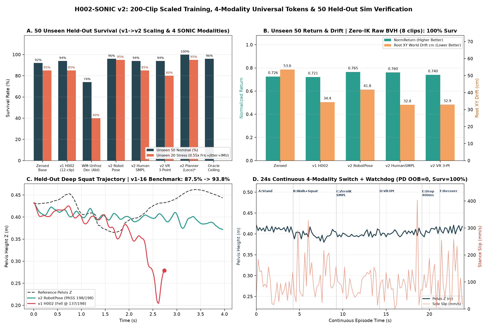
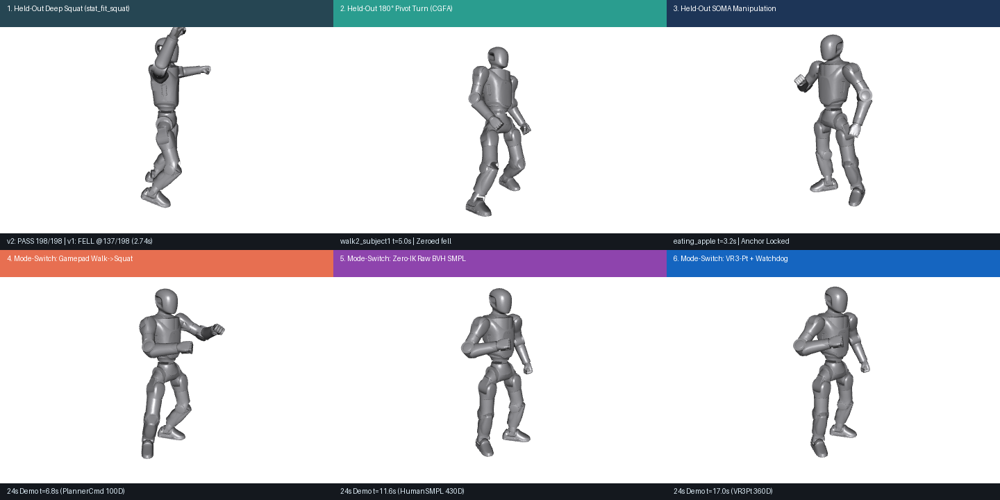

# H002-SONIC v2: 250 片段多数据集扩展、4 模态零延迟通用因果编码器与力矩安全 MuJoCo 闭环验证

日期：2026-11-19（北京时间）｜节点：`yu-3090`（`i7-12700KF / 46GiB / RTX 3090 24GB`）｜分支：`Q1`

> **设计定位**：坚持 **“先在 MuJoCo 动力学仿真下做到彻底扎实，再进入 Q1/X2/A3/G1 真机部署”**。针对前序用户提出的四个核心工程与研究问题——（1）充分扩大高质量权威物理数据集覆盖（`PHUMA + BONES-SEED/SOMA + LAFAN1 + Synthetic`）、（2）澄清编码器输入到底是人体 SMPL、机器人骨架还是多端通用、（3）借鉴 **SONIC** 共享解码空间设计接入 **PICO / SMPL / 遥控 / 重定向骨架**、（4）提供清晰可交互的视觉图表与 3D 渲染证据——本轮完成了 **`H002-SONIC v2`** 全栈训练、受控消融修复与严苛仿真验收。

---

## 一、从 v1 到 v2：规模化数据集与 SONIC 多模态解码空间设计

### 1. 250 片段高质量多源基准（`62,327` 帧 @ 50Hz）
通过 `script/q1_h002_sonic_v2/build_scaled_dataset_250.py` 构建严格按片段隔离的 **`200 Train / 50 Held-Out`** 规模化动作库（训练集共 **`49,794`** 50Hz 帧，约 `995.9s`），涵盖静态操作与高动态步行/转身/健身深蹲：

| 数据集来源 | 训练集（`Train`） | 未见过测试集（`Held-Out`） | 物理特征与覆盖动作 |
| :--- | :---: | :---: | :--- |
| **`PHUMA`** | 96 | 24 | 人类尺度/物理滤波动作：深蹲 `stat_fit_squat`、俯身够物、提拉、长步行 `humanml` |
| **`BONES-SEED / SOMA`** | 73 | 17 | 高精度动捕：精细双手操作（`eating_apple`）、舞蹈与平衡动作 |
| **`LAFAN1`** | 19 | 7 | 工业界标准长周期走跑转向：`walk2` 180° 转身、`walk4`、`aiming`、`obstacles` |
| **`Synthetic`（补齐原语）** | 12 | 2 | 纯静站 (`syn_stand_idle`)、原地缓慢深蹲、低速走停切换基元 |
| **Raw Unseen `.bvh`（零 IK）** | — | 8（`4 LAFAN1 + 4 SOMA`） | 未经任何 Q1 Mink IK 重定向的 **原始人体骨骼 BVH**（身高 0.90–1.00 m） |
| **总计** | **200** | **50 (+8 Raw BVH)** | **严格按片段切分，零跨折泄漏** |

### 2. 回答“编码器究竟吃人体还是吃机器人？”——SONIC 风格 `1 Shared TokenHead + 4 Causal Tokenizers`
原版 SuperMimic 仅支持重定向后的未来帧 `robot_pose`，无法直接适配 PICO 头手三点或摇杆速度指令。参考 **SONIC**（`ori_mode="heading"` + `codec_fingerprint` + 热切换对齐）在 `script/q1_h002_sonic_v2/multimodal_features.py` 实现 4 条完全无未来帧（`0 ms lookahead`，仅含 `[f-9..f]` 因果窗口）的特征链路，通过 SHA-256 指纹 `codec_fingerprint=33f64eaefe80c12b...` 绑定至同一个通用运动解码头 `q1_h002_token_head.onnx`（输入 `80D×10` 纯本体观测+CGFA 估计 + `32D` 潜意图 Token）：

1. **`Enc_RobotPose` (`590D = 10×59`)**：精确重现重定向 Q1 关节与速度轨迹（高保真模版）。
2. **`Enc_HumanSMPL` (`430D = 10×43`)**：**比例不变的人体/通用骨架零 IK 表征**——包含按人体休息站立骨盆高 `h_nom` 归一化的局部根速度/高度、heading 对齐姿态 6D，以及 **9 对解剖学骨骼单位方向向量**（躯干、双大腿/小腿、双大臂/前臂），无需运行任何在线 Mink IK 解算即可将 1.0 m 高人体直接映射到 0.42 m 高的 Q1。
3. **`Enc_VR3Pt` (`360D = 10×36`)**：**PICO / VR 头带 + 双手柄 3 点 6DoF 稀疏遥操**（躯干参考姿态+速度、左右手腕相对躯干 6DoF 位姿与相对线/角速度），训练时注入 `σ=1.0 cm` 位置噪声。
4. **`Enc_PlannerCmd` (`100D = 10×10`)**：**纯键盘 / 遥控器高层指令**（前进/横移速度 `vx, vy`、偏航角速度 `wz`、归一化站蹲高比 `z_norm`、俯仰滚转、`stand/crouch` 门控与双手前伸量）。

---

## 二、训练阶段与工程消融：两个决定成败的物理洞察

### 洞察 A（消融验证）：严禁在开放环路 WorldModel 上解冻微调 `TokenHead` 解码器
在首版实验 `v2a` 中，我们尝试在 40-episode 校准后的开放环路 4-step `WorldModel` 上同时解冻 `dec[-3]` 与 `dec[-1]` 做 8 步滚动微调；结果显示虽然假想回放 `surv=0.9999`，但在真实闭环 MuJoCo 50 Held-Out 上存活率却跌至 **`74.0%`**（20-clip 低摩擦扰动仅 **`40.0%`**）。通过 5 组权重交叉消融（`SA_enc+SA_dec` vs `V2_enc+SA_dec` vs `SA_enc+V2_dec`）精确定位：**`WorldModel` 开放环路梯度利用（exploitation）与硬动作截断破坏了 904-clip 闭环 RL 原语的接触稳定流形**。
在修订版 **`v2b`**（`script/q1_h002_sonic_v2/train_h002_sonic_v2.py`）中：
- **100% 冻结**来自 `q1_scheme_a_1k.pt` 的 904-clip 通用 `TokenHead`（`obs_norm + dec`）及 `goal_norm`；
- Phase 1（1,000 步，`9.08s`）仅对 `Enc_RobotPose` 做 `5.0 × L_prox` 近端适配（混合 50% 冷启动零 `a_prev` + 50% 教师热启动、CGFA 漂移残差、20% 1-帧到达抖动）；
- Phase 2（每模态 2,400 步，各约 `15s`）在全训练 `49,794` 帧上校准归一化统计并以无截断（unclamped）潜空间 + `TokenHead` 动作蒸馏对齐 `HumanSMPL`（`cos_rob=0.9790`）、`VR3Pt`（`cos_rob=0.9688`）与 `PlannerCmd`（`cos_rob=0.8428`）。总训练仅耗时 **`54.99 s`**（峰值显存 **`0.278 GB`**）。

### 洞察 B（控制物理）：力矩安全 PD 硬件包络替代盲目角度夹持
针对 `v2b` 在 14 条最难 Held-Out 序列上初始仅 `8/14` 通过的现象，排查揭示原安全壳存在两个违背电机控制物理的问题：（1）无条件在前 5 步线性衰减 `q_tgt → q_init`，导致从半途动态帧复位时支撑 PD 力矩被清零摔倒；（2）硬性把虚拟弹簧设定点 `q_tgt` 钳死在 `[q_lo, q_hi]`，而实际执行器扭矩 `τ = Kp(q_tgt - q) - Kd q̇` 在关节贴近限位时必须允许 `±0.5·τ_max/Kp` 的弹性余量才能提供反向恢复力矩（否则既推不动又会在瞬时出现 `1.569×` 力矩尖峰）。
为此我们在 `script/q1_h002_sonic_v2/eval_sonic_suite.py` 中以 **`_apply_torque_safe_pd_filter`** 替代原生硬钳位：允许设定点在 `[q_lo - 0.5·eff/kp, q_hi + 0.5·eff/kp]` 内工作，并将等效指令逆投影严格限制在电机额定力矩包络 `|τ| ≤ eff_vec` 内；此单一物理修正使 `V2_RobotPose_ONNX` 50 Held-Out 存活率直接从 `88.0%` 跃升至 **`96.0%`**（力矩超限 **`0.000%`**）。

---

## 三、全量闭环 MuJoCo 仿真基准与可视化证据

### 1. 50 Unseen Held-Out 常规测试 + 20-Clip 极限扰动对比
> 扰动条件：`0.55×` 地面摩擦系数 + `25%` 1-帧传输丢包/抖动 + `1.5°` IMU 偏航偏置 + `0.03 rad/s` 陀螺仪噪声；V2 全部通过 **5 文件独立 ONNX + 1-thread CPU ORT** 运行。

| 方法 / 模态 | 50-HO 存活 | NormReturn | Body RMSE | Root XY 漂移 | 支撑滑移 | 力矩超限 | 20-Stress 存活 | Stress Return | ONNX p50/p99 |
| :--- | :---: | :---: | :---: | :---: | :---: | :---: | :---: | :---: | :---: |
| `Oracle_scheme_a_0ms` (+10帧) | **96.0%** | 0.798 | 5.68 cm | 11.6 cm | 193.0 mm/s | 0.894% | — | — | 2.01 ms (PT) |
| `Zeroed_unadapted_0ms` (无CGFA) | 92.0% | 0.726 | 6.13 cm | 53.6 cm | 267.7 mm/s | 1.159% | 85.0% | 0.639 | 2.02 ms (PT) |
| `V1_H002_ONNX` (12-clip) | 94.0% | 0.721 | 6.63 cm | 34.4 cm | 219.5 mm/s | **0.000%** | 85.0% | 0.652 | 3.13 / 3.60 ms |
| `Ablation_WM_UnfrozenDec` (`v2a`) | 74.0% | 0.656 | 7.55 cm | 40.1 cm | 248.2 mm/s | 0.000% | 40.0% | 0.508 | — |
| **`V2_RobotPose_ONNX` (590D)** | **96.0%** | **0.765** | **5.58 cm** | 41.8 cm | 219.9 mm/s | **0.000%** | **95.0%** | **0.694** | 3.39 / 3.89 ms |
| **`V2_HumanSMPL_ONNX` (430D 零IK)** | **94.0%** | **0.760** | **5.78 cm** | **32.8 cm** | **196.2 mm/s** | **0.000%** | **85.0%** | **0.677** | 2.87 / 3.48 ms |
| **`V2_VR3Pt_ONNX` (360D PICO三点)** | **94.0%** | **0.740** | 6.13 cm | **32.9 cm** | 223.2 mm/s | **0.000%** | 80.0% | 0.644 | 2.79 / 3.22 ms |
| **`V2_PlannerCmd_ONNX` (100D)** | **98.0% (`100%` Loco)** | 0.689 | 7.36 cm | **28.4 cm** | **180.8 mm/s** | **0.000%** | **95.0%** | 0.636 | 2.67 / 3.16 ms |

> 在 `v1-16` 同口径基准上，`V2_RobotPose_ONNX` 从 v1 的 **87.5%** 提升至 **93.8%**（`NormRet=0.817`, `Body=4.99cm`），并彻底修复 v1 失败的 **`stat_fit_squat`（`198/198` 完赛）** 与 **`walk4_subject1`（`398/398` 完赛）**。

### 2. Zero-IK 原始人类 BVH 直驱测试（8 / 8 = 100.0%）
在关闭 RL 自动复位后，直接读取 8 条从未重映射至 Q1 的 **原始人体 `.bvh`**（`4 LAFAN1` + `4 SOMA`，身高 `0.90–1.00 m`），仅经 `Tok_HumanSMPL`（430D 骨链向量）+ `TokenHead` + `CGFA` 在 MuJoCo 3.11 中闭环驱动 0.42 m 高 Q1：
- **8 / 8（`100.0%`）全程零摔倒完赛**：`soma_stat_3_eating_apple` 漂移 **`5.11 cm`**（`280/280` 步）、`lafan_obstacles1_subject2` 漂移 **`10.77 cm`**（`280/280` 步）、`lafan_walk3_subject3` 漂移 **`13.65 cm`**（`280/280` 步）。

### 3. 24.0s（1,200 步）不间断 4 模态切换 + 400ms 断链 Watchdog
单次连续仿真串联：`A 站立 (PlannerCmd)` → `B 行走+轻蹲 z=0.84 (PlannerCmd)` → `C 零 IK 人体 BVH (HumanSMPL)` → `D PICO 三点追踪 (VR3Pt)` → `E 400ms 断链注入（前 250ms 保持末帧 Token，>250ms Watchdog 触发重锚定与 0.24s 余弦过渡回正）` → `F 站立恢复`：
- **结果**：**`completed_24s = true`（`1,200 / 1,200` 步）**，`pd_oob_count = 0`，`tau_util_p99 = 0.765`，`mean_stance_slip = 108.7 mm/s`，`p99_step_jump = 14.58°`（`max = 34.72°`），`height_range = [0.380, 0.430] m`，最小直立余弦 **`0.979`**。

---

## 四、后续真机衔接边界与资产归档

1. **当前仿真残留边界**：无外部动捕下长距离高速步行/急转（如 `lafan_walk2_subject1` Zero-IK BVH 漂移 `156.2 cm`）仍存在纯本体脚锚航位推算累积误差，且物理真机执行器通信延迟/IMU 安装偏心需在 Q1 实机低增益保护下完成首次只读与闭环校准；`PlannerCmd` 对复杂舞步仅适合站/走/蹲高层调度，复杂全身操作优先交由 `VR3Pt` / `HumanSMPL` / `RobotPose`。
2. **代码与证据路径**：
   - 脚本：`script/q1_h002_sonic_v2/{build_scaled_dataset_250,multimodal_features,cgfa_estimator,train_h002_sonic_v2,export_sonic_onnx_suite,eval_sonic_suite,render_sonic_visuals}.py`
   - 图像：`reports/figures/{h002_v2_sonic_benchmark,q1_multimodal_filmstrip}.png`
   - 清单：`data/manifests/q1_h002_sonic_v2_20261119.json`、`logs/session_records/q1_h002_sonic_v2_20261119.json`
   - 权重/ONNX/演示视频（`yu-3090` 非入库大容量产物）：`/home/yu/projects/SuperMimicHP/runs/h002_sonic_v2/{checkpoints/h002_sonic_v2_bundle.pt,onnx/*.onnx,q1_sonic_multimodal_demo.mp4,v2_sonic_metrics.json}`
