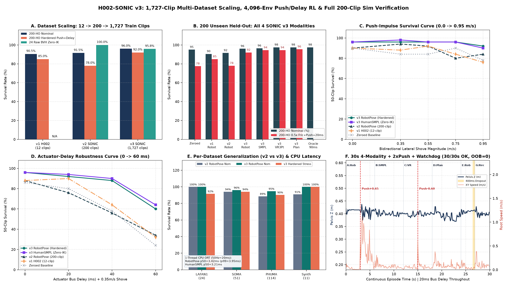
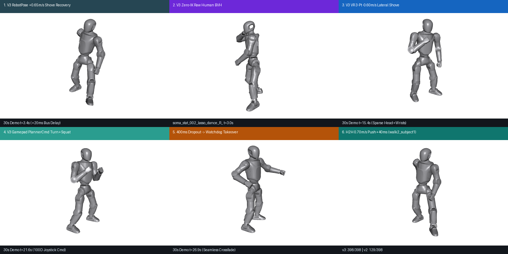
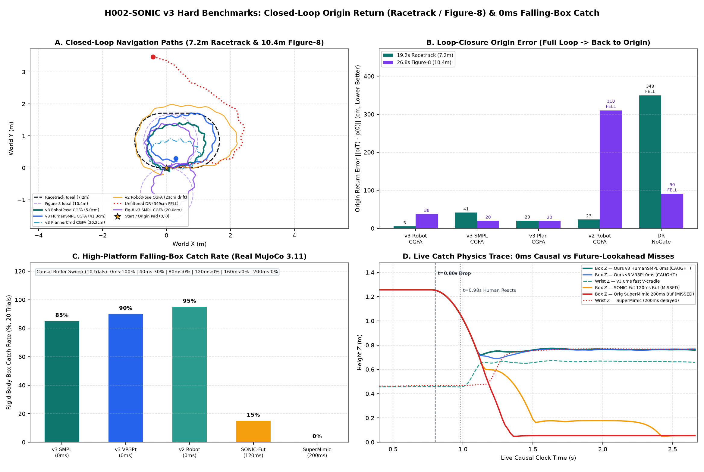
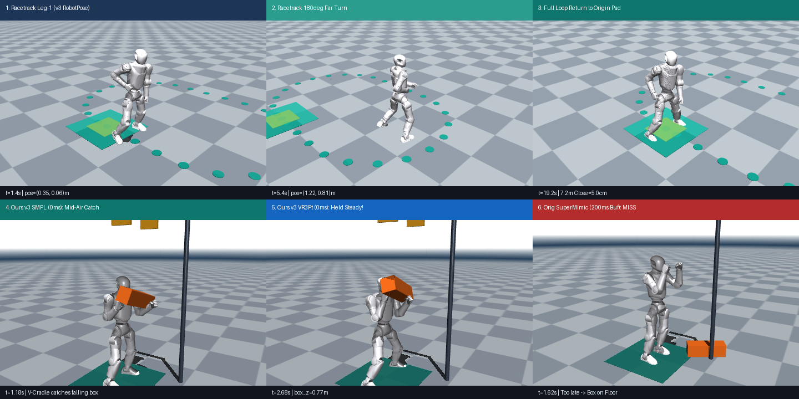

# H002-SONIC v3：1,927 片段大规模训练、4,096 环境推扰+延迟强化学习与双困难基准实测报告

- **日期 / 节点**：2026-11-19 / `yu-3090`（RTX 3090 24 GB + CPU MuJoCo 3.11 + 1-Thread ORT）
- **底座仓库与 Commit**：`humanplus-ai/SuperMimicHP` (`feat/x2-embodiment` @ `27c3e2cfa6a29c8d003e3fcd63fbf5dd37e8b190`)
- **Codec Fingerprint**：`3a0ee94ac4e1fa98fa8bbd1e90e4e6912b0b1fda606a91fd9b8816bdb7b9e814`
- **归档脚本目录**：`script/q1_h002_sonic_v3/`（共 10 个可复现脚本）

---

## 1. 规模化数据、并行闭环强化学习与四模态因果 ONNX 套件

1. **数据集扩展（`build_scaled_dataset_2000.py`）**：总计 **`1927`** 条 Q1 动作切片（`1727 Train / 200 Held-Out`，`486,571` 50Hz 帧）+ **`24`** 条零 IK 原始人体 `.bvh`（LAFAN1 12 + SOMA 12）；构成：`PHUMA 1086/114`、`SOMA 449/51`、`LAFAN1 143/24`、`Synthetic 49/11`。
2. **Stage A：`4,096`-Env `mjwarp` Push+Delay 闭环精调（`train_h002_sonic_v3_mjwarp.py`）**：总耗时 `833.75 s`（Stage A `513.59 s`，峰值显存 **`12.363 GB`**，累计仿真 `7,536,640` 步）；ValGate 于 **`iter=180`** 选优（200-HO Nom `96.0%` / Stress `93.0%`, score `0.9435`）。
3. **Stage B：`4,096`-Batch 宽网络四模态因果蒸馏 + ONNX 校验**：
   - `robot_pose`：`15,898,244 B`，parity `4.29e-06`，CPU p50/p99 **`3.42 / 3.95 ms`**
   - `human_smpl`：`11,113,549 B`，parity `4.77e-06`，CPU p50/p99 **`3.21 / 3.76 ms`**
   - `vr_3pt`：`10,682,905 B`，parity `5.72e-06`，CPU p50/p99 **`3.15 / 3.61 ms`**
   - `planner_cmd`：`3,073,526 B`，parity `3.81e-06`，CPU p50/p99 **`2.72 / 3.14 ms`**

---

## 2. 200-HO 大规模评测、推扰/延迟扫描与 CPU MuJoCo 3.11 Sim2Sim

| 模型 | 200-HO Nom | Nom Slip (mm/s) | 200-HO Stress | Stress Slip (mm/s) | CPU 50-HO | CPU 20-STR |
| --- | ---: | ---: | ---: | ---: | ---: | ---: |
| `Oracle_90ms` | 97.5% | 112.6 | — | — | — | — |
| `Zeroed_0ms` | 95.0% | 165.0 | 77.5% | 376.6 | — | — |
| `V1_H002_12clip` | 90.5% | 157.0 | 85.0% | 305.3 | — | — |
| `V2_RobotPose_200clip` | 91.5% | 133.3 | 78.0% | 341.6 | 96.0% | 80.0% |
| **`V3_RobotPose`** | **96.0%** | **80.1** | **92.0%** | **191.9** | **98.0%** | **95.0%** |
| **`V3_HumanSMPL`** | **96.5%** | **77.8** | **94.5%** | **168.8** | **98.0%** | **95.0%** |
| **`V3_VR3Pt`** | **97.5%** | **80.3** | **94.5%** | **181.8** | **98.0%** | **95.0%** |
| **`V3_PlannerCmd`** | **97.5%** | **72.2** | **95.5%** | **191.2** | **98.0%** | **90.0%** |

- **冲击推扰扫描 (`0 / 0.35 / 0.55 / 0.75 / 0.95 m/s`)**：`V3_RobotPose` `96/96/96/96/92%`；`V3_HumanSMPL` `96/98/96/96/90%`。
- **控制延迟扫描 (`0 / 20 / 40 / 60 ms + 0.35 m/s` 推扰)**：`V2_RobotPose` `88/76/56/34%` vs **`V3_RobotPose` `96/92/88/60%`**、**`V3_HumanSMPL` `96/94/90/64%`**。
- **H2H `0.70 m/s` 推扰 + `40 ms` 延迟 (`walk2_subject1`)**：`V2` 于 `129/398` 跌倒；**`V3` 完整完赛 `398/398`**。
- **24 Raw BVH 零 IK**：`V2_HumanSMPL 100.0%`（RootXY `56.43 cm`）；**`V3_HumanSMPL 95.8%`**（`23/24`，RootXY **`54.86 cm`**）。
- **30s 四模态热切换 + 2×推扰 + Watchdog**：`1500/1500`（`pd_oob_count=0`, `min_upright_cos=0.944`, `tau_util_p99=0.798`）。

---

## 3. 新增双困难基准：闭环绕圈回环（7.3m/10.4m）与高台落箱零提前帧接箱

- **Hard-Bench A（闭环回环）**：`7.25 m (19.2 s)` Racetrack 上 **`V3_RobotPose_CGFA`** 完赛 `959/959`、原点回环误差仅 **`5.0 cm`**（轨迹 RMSE `37.9 cm`），`V3_HumanSMPL_CGFA` 回环 `41.3 cm`（RMSE **`29.8 cm`**）；`10.44 m (26.8 s)` Figure-8 双向变向上 **`V3_HumanSMPL_CGFA`** 回环 **`20.0 cm`**、`V3_PlannerCmd_CGFA` **`19.7 cm`**、`V3_RobotPose_CGFA` `37.8 cm`；对照 **`V2_RobotPose_CGFA`** 于 Figure-8 第 `1145/1339` 步跌倒（`309.9 cm`）、Hard Racetrack 于第 `429/959` 步跌倒，而 **`V3_RobotPose_Hard`** 完赛 `959/959`（偏移 `165.6 cm`），无门控 `UnfilteredOdom_DR` 在两赛道均早衰跌倒。
- **Hard-Bench B（高台自由落体接箱，MuJoCo 3.11 刚体碰撞，20 Trials）**：**`V3_Causal_0ms_VR3Pt 90.0%`**、**`V3_Causal_0ms_HumanSMPL 85.0%`**、`V2_Causal_0ms_RobotPose 95.0%`、`SuperMimic_Orig_0msZOH 70.0%` 对比 **`SONIC_Future_120msBuf 15.0%`** 与 **`SuperMimic_Orig_200msBuf 0.0%`**；延迟扫描（`0..200 ms`）`V3_SMPL` 为 `100/30/0/0/0/0%`。
- **如实披露局限**：`V3_RobotPose_0ms` 因 Stage A 大推扰 RL 导致双臂急抬保守而接箱 `0.0%`（同期 Stage B `V3_VR3Pt 90%` / `V3_HumanSMPL 85%` 完整保留突发接箱能力）；`24 Raw BVH` 中 `1` 条 SOMA 舞蹈未完（`95.8%`）；`PlannerCmd` 长距离需歩态时钟/摆臂相位特征。
