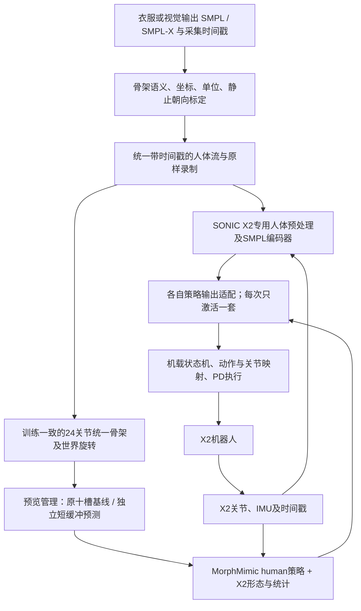

# X2 的 SMPL 遥操：近期仓库核查与 SuperMimic 部署方案

核查日：2026-11-12，北京时间。重点检索区间为10月22日至11月12日，同时检查更早发布但仍可复用的X2部署项目。本次只有公开网络检索、文档和源码静态阅读，没有服务器登录、安装、权重下载、仿真、训练或机器人控制；应用目标保持用户暂停。

## 用户版 done / todo

done：找到可公开读取的第三方X2 SONIC完整SMPL遥操栈，以及覆盖X2的MorphMimic人体策略。智元官方10月30日更新的A3遥操栈可参考，但没有SMPL编码器，也不是X2策略。没有取得“智元官方X2 SuperMimic已完成SMPL真机遥操”的公开完整证据。

todo：先复用X2 SONIC部署栈建立SMPL输入和硬件状态反馈基线，再把MorphMimic X2 human策略接到同一底层。先保留原预览等待验证完整链路，再独立比较短缓冲补全和时间mask适配。当前阶段只给出设计，不恢复旧Q1/G1训练或派发新实验。

## 检索范围与证据口径

通过联网搜索、GitHub公共API、原始文件与git ls-remote交叉查阅。API返回SuperMimic关键词178个候选中的前100个，并枚举AgibotTech当时33个公共仓库；另查X2/SMPL、X2/SONIC、跨本体和sim2real关键词。重点阅读17个仓库的README及相关部署源码，并固定10个候选HEAD；这些计数表示发现和阅读范围，不表示全部候选逐源码审计，也不表示穷尽互联网。

首次搜索连接失败，随后恢复；GitHub API后来触发匿名限额，改读公开raw文件及git远端。搜索摘要、awesome列表和社交镜像只作线索，结论优先由作者源码、发布文档或项目页支持。README中的真机报告仍是作者报告，本次没有复跑或观看并验收所有完整视频。源码可读取与权重、依赖齐全和运行成功分别记录。

### 最直接相关的项目

| 项目 | 本次能核实的公开能力 | 对X2 SMPL遥操的意义与边界 |
|---|---|---|
| [官方SuperMimic](https://github.com/HybridRobotics/supermimic) | 11月10日公开的G1世界模型/策略训练及play入口，HEAD abc124c1；依赖[mjlab_research](https://github.com/HybridRobotics/mjlab_research)，本次该依赖也可读取 | 官方算法参照；README只列G1的GenCoord/MaxCoord任务，没有提供X2 SMPL真机一键入口 |
| [MorphMimic](https://github.com/lzyang2000/morphmimic) | 共享G1/X2 Ultra/T2、v0.1统一ONNX、24关节及五点human接口、PICO streamer | 最接近低成本SuperMimic系X2人体策略。作者明确发布权重只在G1真机测试，X2/T2只做仿真；原run.py硬件选项只有g1，X2仍需硬件适配层 |
| [X2 SONIC完整栈](https://github.com/meetsitaram/GR00T-WholeBodyControl-X2/tree/supermimic-deploy) | 可读README_X2、MODELS及F03/F10；X2 SMPL输入、ONNX模型清单、C++部署、PC2、MuJoCo及PICO回放；HEAD ceccba97 | 当前最值得借用的X2部署参考。它是第三方，不是智元官方。分支名含supermimic-deploy，但当前主文档/模型清单是SONIC，不能据名字把它当成已完整核验的SuperMimic训练与SMPL部署套件 |
| [X2 SONIC项目页](https://sonic-agibot-x2.github.io/) | 作者提供X2 Ultra真机行走、舞蹈、全身VR遥操演示说明；27段PICO/SMPL录制的成功率66.7%是IsaacLab评测 | 支持X2人体遥操已有公开先例；66.7%不能当现场真人成功率或SuperMimic结果 |
| [智元官方sonic_for_a3](https://github.com/AgibotTech/sonic_for_a3) | 10月30日发布089/136k、实时XR重定向、ONNX/RKNN、A3/A3U真机流程 | 新近官方工程参考，明确仅G1/A3-fast编码器，没有SMPL或teleop编码器；需要上游重定向，不能拿其权重直接控制X2 |
| [RoboJuDo-Plus](https://github.com/chifongip/RoboJuDo-Plus) | 第三方X2 AimDK/ROS2后端、按名映射关节、IMU、50Hz策略和500Hz后端发布、超时状态机 | 可作为MorphMimic X2硬件后端候选。不是换ONNX就完成适配：其现有151维/430维观测不同于MorphMimic；文档保留里程计/IMU待核问题 |
| [Breezewrf/supermimic_mjlab](https://github.com/Breezewrf/supermimic_mjlab) | 作者报告SuperMimic接RoboJuDo-Plus完成G1 23DoF sim2real | 证明部署框架可接SuperMimic类策略；不是X2 SMPL遥操结果 |
| [NJU SuperMimic-Repro-Sim2Real](https://github.com/NJU-R-L-Group-Embodied-Lab/SuperMimic-Repro-Sim2Real) | 发布G1舞蹈真机报告、模型与部署说明 | 值得读执行器/导出经验；特定舞蹈回放不等于实时SMPL遥操，机器人也不是X2 |
| [SuperMimicKit](https://github.com/OMEGA-i/SuperMimicKit)、[supermimic-retargeted](https://github.com/tianshuwu/supermimic-retargeted) | G1/H2/A3跨本体预览；后者包括X2数据和仿真适配 | 支持本体迁移与数据处理，不足以证明X2实时人体输入真机部署 |

另检查RaraAlu/Supermimic、Renforce-Dynamics/trackerlab-supermimic、Motphys/Uni-SuperMimic、KyrieYoung926/supermimic_deploy、meetsitaram/sonic-x2、TaiE64/AgibotX2-Retargeter。它们分别偏训练、G1部署、仿真播放或重定向，没有取得替代上述X2完整人体部署链的新确证。

### X2 SuperMimic声明及链接纠正

检索发现Sitarama Chekuri在10月23日发出的X2 SuperMimic对比声明。社交镜像给出原帖地址 `https://x.com/meetsitaram/status/2113781639189090501`，指向 `meetsitaram/GR00T-WholeBodyControl-X2/tree/supermimic-deploy`。旧播放包链接的 `GR00T-WholeBodyControl-X2-review` 本次返回404，**不能据旧地址断言正确仓库不可用**；正确仓库raw文件可读，git远端分支SHA已核。

本次没有从可读的一手训练结果工件独立复核社交声明中的SuperMimic benchmark、权重身份及其SMPL真机链，故不把传播的成功率/训练时长作为已核实指标，也不由舞蹈说明推出实时遥操完成。正确分支当前可读的是详细SONIC部署文档；应在后续源码审计中定位SuperMimic实现、导出契约和对应权重，再判断其是否比MorphMimic更适合作为主策略。

## 智元官方核查结果

本次AgibotTech列表中与任务直接相关的是sonic_for_a3、agibot_x2_urdf，以及IsaacCapture。后者是NVIDIA/IsaacCapture的fork，可作采集基础设施参考，没有取得X2 SuperMimic策略证明。X1 infer/train、GenieSim及灵巧手SDK也不能当成X2人体跟踪权重。

[官方X2模型仓库](https://github.com/AgibotTech/agibot_x2_urdf)区分Ultra v1.3.0、Ultra-N及EDU v1.4.0。现有MorphMimic X2 Ultra配置不能自动覆盖不同电机/结构版本。项目准备阶段先查本机既有资产和设备资料；实际型号无法由资料确定时才需要用户补充。

[官方A3说明](https://github.com/AgibotTech/sonic_for_a3/blob/0311d712e3d6febbafd58dcb8b09417e4b2a3bb1/README.md)写明两发布点无SMPL编码器，A3-fast十帧、20ms步长，未来到180ms；它的“fast”不能解释为无未来依赖。

## 推荐遥操流：一个人体入口，两套完整策略对照

这里共享的是人体原始流、硬件后端与记录口径，**不共用SONIC与MorphMimic的归一化、编码器latent、动作尺度或PD配方**。不把SONIC tokenizer输出送MorphMimic decoder。SuperMimic世界模型主要用于训练；第一版遥操在线只运行冻结策略，无需把WM预测或训练服务塞进20ms控制周期。

### 1. SMPL接入与标准人体表示

输入记录`sequence/capture_time/arrival_time`、模型族、旋转表示、根平移、有效性与置信度。SMPL-X显式映射到目标24槽，排除手指；局部轴角需沿父链求世界旋转。每套策略使用各自训练一致的轴向、rest frame和骨架尺度，不能仅凭“24关节”认定数据一致。

MorphMimic human路径用其`human_skeleton.json`统一骨长、重建位置、处理根高/地面和初始朝向；不是任意体型SMPL关节点直接替换PICO数据。其目标为每关节位置米和世界四元数wxyz，窗口[K,168]。原始动捕无需先做每帧X2 IK；只有选择motion接口备选路线时，才用GMR等生成机器人参考。当前PICO streamer应改为可插拔设备源，保留其目标构造与标定语义。

### 2. 未来窗口：先跑通，再缩短

本次[精确常量](https://github.com/lzyang2000/morphmimic/blob/770394b4a0cad9effbf807a6c03435d1699733d0/deploy/vr_teleop/constants.py)为50Hz、GOAL_K=10、DELAY=9：窗口含当前帧，首末跨度180ms。旧Q1评估取下一帧至第十帧时为200ms，必须按时间戳比较，不能把180/200差别当优化。X2 SONIC standalone SMPL源码也明确以约180ms旧帧作为窗口起点；该脚本标SIM-ONLY，真机须走F03的deploy-faithful链。

版本B0保留原时序，先建立真实人体跟随基线；测量从采集到发布、执行及身体响应的总延迟。版本B1才把真实缓冲目标降至80ms以内，以已到达帧和历史做位置/SO(3)阻尼补全，逐槽标measured/generated，禁止读取截止后的真实帧。B2在B1有明确闭环退步时，才做独立短预览/时间mask适配，维持完整预览旧能力。

不能把200ms的十帧轨迹改标成80ms：这相当于加速动作，会改变速度、加速度和接触时序。也不能把当前Q1的H4结果外推X2；不同本体、权重和原始支持规则均需新匹配对照。现有f0方案失败，不作为首版主线。任何训练预算/目标恢复另按用户后续指令，不在本次检索中自动启动。

### 3. X2机器人反馈与执行适配

- 优先复用已核X2 SONIC PC2/C++部署或RoboJuDo的AimDK连接层；新增独立MorphMimic policy适配器，不能让现有151/430/990维观测冒充MorphMimic的93维单帧历史。
- 从checkpoint导出的robot JSON读取名称、符号、offset、default和action scale。MorphMimic用29个canonical body槽映射31个native关节，头关节默认保持；腕yaw/roll交换、腕符号和肘offset均须严格复现，不能简单补零/按序复制。
- 关键发现：MorphMimic X2的训练/部署观测要求pelvis IMU，而RoboJuDo文档订阅torso IMU。应优先取得匹配传感器；若只能拿到torso姿态和gyro，需要按腰部FK、关节速度及传感器外参还原pelvis姿态和角速度，并做同状态数值验证。不能只改四元数而遗漏gyro坐标和腰部相对运动。
- 默认参考锚点模式可由IMU/关节反馈构造，不先把全局里程计设成必要条件；若换robot-anchor权重，必须满足它的额外世界位姿要求。停止原MC后其leg_odometry可能消失，是公开后端已经指出的依赖问题。
- 人体流和机器人状态的超时分别处理；进出跟随需要平滑过渡及独立急停。上游3秒人体超时属于参考实现，不能直接照搬为本机执行看门狗。具体期限按本机反馈和执行周期验证后确定。
- 控制环在机载或机器人局域网；Windows SSH桥只负责开发，不承担电机闭环。GPU用于训练、视觉或经实测受益的推理；小ONNX若机载CPU更稳则使用CPU，按完整周期p95/p99决定，不能只测前向。

## 最省训练的实施顺序与交付

1. 固定X2真实型号与资产、完整策略/归一化/配置身份，取一段现有SMPL录制。逐帧对照SMPL和标准人体骨架、根高、朝向及时间戳，先排接入错误。
2. 复用X2 SONIC发布模型跑其SMPL回放与sim deploy，建立可用工程基线。与MorphMimic同人体源、同硬件记录对照，分别保留模型训练的控制契约，不以换PD美化单方。
3. 使用现有MorphMimic统一发布X2策略，先人体录制，再真人流驱动MuJoCo；输出原速人/目标/实际机器人并排视频、跟踪误差、离地/换脚、承重滑移、侧倾、动作突变、超时/恢复和完整周期时延分布。
4. 硬件后端先只读与shadow核数值/时序，再在防护条件下验证站立、上肢、移重和小步；推进前保持只有一个命令发布者。实际真机操作需另有明确部署任务和现场条件，本次没有执行。
5. B0完整链路可用后，比较B1/B2延迟—质量曲线。只因模型/动力学差距而有证据需要时，单独X2微调；不重开已暂停的G1+Q1共享训练。最小新训练目标是短预览适配或执行器延迟校准，避免先从零训练整个系统。

首个交付应是“同一实时SMPL源驱动仿真X2，保留真实网络时间戳”的演示与记录，随后是硬件shadow一致性。真人与机器人同步完整视频及真实延迟证据，才决定是否达到自然遥操；不以离线回放、loss或模型文件存在结算。

## 来源与保存

固定版本、原文件大小SHA与检索边界见[检索收据](../logs/session_records/x2_smpl_supermimic_research_20261112.json)。第三方原始文档/源码快照放被忽略的`data/references/x2_smpl_supermimic_research_20261112`，不作为本项目原创源码提交。没有下载模型大文件或执行第三方脚本。十份README经HEAD和固定提交读取逐字节核同；新找到X2完整分支另核真实远端ceccba97。

此前未完成的`dependency_preview_worker.py`仍为未测试未发布草稿，原训练保持暂停；本阶段不改其代码。Q1既有5036秒预算台账未读取服务器新值或重置。服务器文档镜像未尝试，状态PENDING；Git与Mac发布以后续独立publication收据为准。
